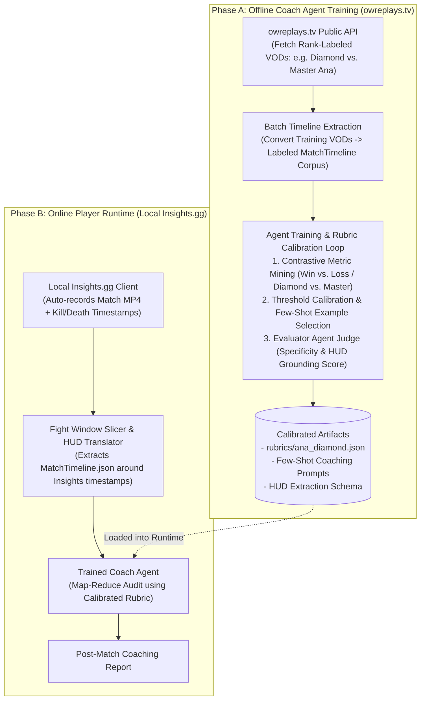

# System Architecture & Design Philosophy (`ow-ai-coach`)

## 1. Core Architectural Split: Offline Agent Training vs. Online Local Runtime

A key design principle of `ow-ai-coach` is strictly separating **Offline Coach Agent Training** from **Online Player Runtime**:

* **Offline Training Phase (`owreplays.tv` Dataset)**:
  - `owreplays.tv` is used **exclusively as an offline training and calibration dataset**, never as a runtime dependency for players.
  - Because `owreplays.tv` provides thousands of public, rank-labeled (Bronze through Champion), hero-tagged first-person VODs alongside community/coaching comments, we use it to **train, calibrate, and evaluate** our `TimelineTranslator`, `Rubrics`, and `CoachAgent`.
* **Online Runtime Phase (Local `Insights.gg` Integration)**:
  - During actual gameplay on the user's PC, `owreplays.tv` is completely out of the loop.
  - `Insights.gg` (via Overwolf Game Events Platform + NVIDIA NVENC) runs locally in the background, automatically recording the full match `.mp4` and logging exact event timestamps (`match_start`, `kill`, `death`, `match_end`) with zero manual hotkeys.
  - Our local pipeline ingests the `Insights.gg` video + event bookmarks directly and runs the pre-trained Coach Agent.

---

## 2. Problem Statement & Why Generic AI Coaching Fails

Building an automated AI coaching platform for *Overwatch 2* faces three primary bottlenecks:

1. **Closed Replay Telemetry & Input Friction**:
   - Unlike *Counter-Strike 2* or *Dota 2*, Blizzard does not expose downloadable replay telemetry files (`.dem`).
   - At runtime, local `Insights.gg` auto-capture eliminates manual recording and uploading friction.
2. **Multimodal Attention Bottleneck**:
   - Feeding a raw 15-minute 60fps gameplay video directly into a generic Vision-Language Model (VLM) fails because the model cannot simultaneously track the top-right killfeed, bottom-left HP bar, bottom-right cooldown timers, and 3D positioning in a single pass.
3. **"Correct Nonsense" (Generic AI Platitudes)**:
   - Prompting a generic LLM with *"You are a Grandmaster Overwatch coach"* yields unactionable advice such as *"use cover more"*, *"improve your aim"*, or *"communicate with your team"*.
   - Furthermore, evaluating a Gold/Diamond player against professional OWCS standards is counterproductive; Ground Truth rubrics must be calibrated specifically for the player's **Hero** and **Skill Tier**.

---

## 3. How Offline Coach Agent Training Works (`owreplays.tv`)

Since we do not fine-tune model weights directly, **"training the Coach Agent"** consists of **Data-Driven Rubric Calibration, Contrastive Rule Discovery, and Prompt/Few-Shot Optimization** using `owreplays.tv` VODs:

### Step 1: Curating Rank-Stratified Training Batches (`scraper/owreplays_client.py`)
We pull targeted cohorts from `owreplays.tv`:
* **Target Cohort**: e.g., 10–20 **Diamond Ana** matches (split between Wins and Losses).
* **Reference Upper Cohort**: e.g., 10 **Master / Grandmaster Ana** matches on the same map types.
* **Coaching Ground Truth**: Matches with existing human VOD review comments or transcripts (e.g., Spilo Coaching VODs + `owreplays.tv` comment threads).

### Step 2: Contrastive Timeline Mining
We run `agent/timeline_translator.py` across the training cohorts to convert raw videos into structured `MatchTimeline.json` files and compute empirical distributions:
* *Example Discovery*: Suppose across 10 Master Ana VODs, offensive purple anti-nades account for `58%` of all Biotic Grenades thrown, whereas in Diamond Ana losses, offensive anti-nades drop to `24%` (with `76%` spent on self-heals after taking poke damage or overhealing high-HP tanks).
* This updates `ANA_DIA_01`'s empirical threshold in `rubrics/ana_diamond.json` (`offensive_anti_ratio < 0.45`).

### Step 3: Iterative Evaluator-Optimizer Training Loop
For each training match from `owreplays.tv`:
1. **Forward Pass**: `TimelineTranslator` $\rightarrow$ `MatchTimeline.json` $\rightarrow$ `CoachAgent` produces a draft coaching report.
2. **Critique / Loss Evaluation**: An **Evaluator Agent** grades the generated report against 4 criteria:
   - **HUD Verification Accuracy**: Did the timestamped critique match the actual HUD state (`alive_ratio`, `cooldown_state`) in the video frame?
   - **Zero-Platitude Compliance**: Did any generic advice slip through?
   - **Outcome Alignment**: Do the identified habit root causes explain why Fight #X was won vs. lost?
   - **Human Coach Alignment**: Does the AI diagnosis match human coaching feedback on that VOD?
3. **Backward Update (Rubric & Prompt Mutation)**: We refine the HUD extraction prompt, adjust rubric rule thresholds, and store validated high-precision critiques as **Few-Shot Exemplars** for the Coach Agent.

---

## 4. Online Runtime Pipeline (Local `Insights.gg`)

Once the Coach Agent and Rubrics are trained offline, the player's local workflow is completely automatic:

### 4.1 Local Ingestion (`Insights.gg` Watcher)
* `Insights.gg` automatically records the match and writes local metadata containing exact timestamps for every `kill`, `death`, and `round_end`.
* Instead of scanning an entire 15-minute video blindly, our local slicer extracts **20–40 second teamfight windows** anchored around `Insights.gg`'s event timestamps.

### 4.2 Stage 1: Video-to-Timeline Translator (`agent/timeline_translator.py`)
The VLM acts strictly as an **objective HUD logger** (`1–2 FPS` around teamfights), inspecting four fixed 16:9 regions to produce `MatchTimeline.json`:
* **Top-Right (Killfeed)**: Live alive count (`5v5`, `4v5`, `3v5`) and `dead_allies`.
* **Bottom-Left (HP Bar)**: Player HP (`0–250`) and status effects.
* **Bottom-Center (Ultimate)**: Ultimate charge (`0–100%`).
* **Bottom-Right (Abilities)**: Sleep Dart (`ready` vs `cd:Xs`) and Biotic Grenade classification (`offensive_anti`, `defensive_heal`, `self_heal`).

### 4.3 Stage 2: Match-Level Map-Reduce Coach (`agent/coach_agent.py`)
1. **Micro Audit (Map)**: Evaluates each teamfight against the pre-trained rubric (`rubrics/ana_diamond.json`), requiring every critique to cite `[Timestamp] + [Alive Ratio] + [Cooldown State]`.
2. **Macro Aggregation (Reduce)**: Aggregates metrics across all fights in the match to surface the player's top 2–3 recurring habit root causes.
3. **Negative Constraint Guardrail**: Programmatically blocks any output containing banned generic platitudes.
