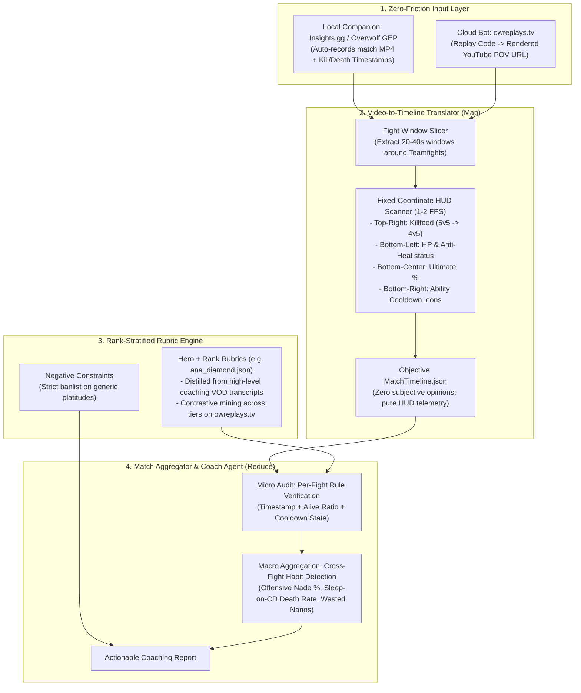

# System Architecture & Design Philosophy (`ow-ai-coach`)

## 1. Problem Statement & Core Challenges

Building an automated AI coaching platform for *Overwatch 2* faces three primary bottlenecks:

1. **Closed Replay Telemetry & Input Friction**:
   - Unlike *Counter-Strike 2* or *Dota 2*, Blizzard does not expose downloadable replay telemetry files (`.dem`). Replay codes only render inside the game engine.
   - Requiring players to manually record 2GB MP4 files via OBS and upload them to a web form creates fatal user friction.
2. **Multimodal Attention Bottleneck**:
   - Feeding a raw 15-minute 60fps gameplay video directly into a generic Vision-Language Model (VLM) fails because the model cannot simultaneously track the top-right killfeed, bottom-left HP bar, bottom-right cooldown timers, and 3D positioning in a single pass.
3. **"Correct Nonsense" (Generic AI Platitudes)**:
   - Prompting a generic LLM with *"You are a Grandmaster Overwatch coach"* yields unactionable advice such as *"use cover more"*, *"improve your aim"*, or *"communicate with your team"*.
   - Furthermore, evaluating a Gold/Diamond player against Overwatch Champions Series (OWCS) professional standards is counterproductive; Ground Truth rubrics must be stratified by **Hero** and **Skill Tier**.

---

## 2. End-to-End Architecture

To solve these challenges, `ow-ai-coach` decouples **Video Capture**, **Objective HUD Perception**, **Rank-Stratified Rubric Grounding**, and **Map-Reduce Match Aggregation**:

---

## 3. Module Breakdown

### 3.1 Zero-Friction Input Layer
Instead of writing custom screen-encoding drivers or touching game memory (which risks anti-cheat flags), we piggyback on established, whitelisted ecosystems:
* **Local Real-Time Mode (`Insights.gg` / Overwolf GEP + NVIDIA NVENC)**:
  - Automatically detects `Overwatch.exe` match start, kills, deaths, and match end without manual hotkeys.
  - Saves full match recordings and event bookmark metadata locally, which our local watcher ingests automatically.
* **Cloud / Dataset Mode (`owreplays.tv`)**:
  - Provides a public JSON API (`/api/v2/replays`) and automated cloud recording bots that turn 6-character replay codes into rendered first-person YouTube VODs categorized by Hero, Map, and Skill Tier.
  - Gemini's multimodal API ingests YouTube URLs directly without requiring local video downloads.

### 3.2 Stage 1: Video-to-Timeline Translator (`agent/timeline_translator.py`)
The VLM is strictly forbidden from giving coaching opinions during Stage 1. It acts solely as an **objective HUD logger**, sampling fixed screen regions at `1 FPS` per teamfight to produce `MatchTimeline.json`:
* **Killfeed State**: Live player count (`5v5`, `4v5`, `3v5`) and recently eliminated teammates (`dead_allies`).
* **Resource State**: Exact cooldown status of key abilities (`ready` vs `cd:Xs`) and Ultimate charge (`0-100%`) at the exact second an engagement or death occurs.
* **Action Classification**: For example, classifying every Biotic Grenade throw as `offensive_anti`, `defensive_heal`, or `self_heal`.

### 3.3 Stage 2: Rank-Stratified Rubric Generation (`rubrics/`)
Ground Truth differs drastically by skill tier:
* **Gold/Platinum Focus**: Stopping 1v5 staggers, not dying with unspent cooldowns, basic Ultimate timing.
* **Diamond Focus (`rubrics/ana_diamond.json`)**:
  - `ANA_DIA_01` (**Biotic Grenade Value**): Shifting from passive defensive/self-heal nades to fight-winning offensive purple anti-nades (Target: $\ge 50\%$ offensive ratio).
  - `ANA_DIA_02` (**Sleep Dart Discipline**): Never firing "lottery/poke" Sleep Darts at enemy tanks when enemy Dive/Flank threats (`Winston`, `Tracer`, `Genji`, `Doomfist`) have not committed their mobility cooldowns.
  - `ANA_DIA_03` (**Nano Boost Fight Economy**): Never panic-investing Nano Boost when down $\ge 2$ players (e.g., `3v5` after main tank dies).
  - `ANA_DIA_04` (**Healbot Tunnel Vision vs. Damage Weaving**): Avoiding continuous hard-scoped overhealing on $>85\%$ HP allies when enemy squishies are exposed in line of sight.

**How Rubrics Are Scaled Across Heroes & Ranks**:
1. **Transcript Distillation**: Scraping categorized VOD review transcripts from professional coaches (e.g., Spilo Coaching's 1,000+ rank-tagged reviews) and converting recurring critiques into verifiable HUD `IF-THEN` rules.
2. **Contrastive Timeline Mining**: Running the Timeline Translator across Grandmaster vs. Diamond VODs on `owreplays.tv` to extract empirical statistical thresholds.

### 3.4 Stage 3: Match-Level Aggregation & Anti-Platitude Auditing (`agent/coach_agent.py`)
Analyzing isolated deaths misses systemic player habits. The Coach Agent performs a **Map-Reduce** evaluation:
1. **Micro (Map)**: Audits every event in `Fight #1 ... #N` against the active rubric, requiring every critique to cite `[Timestamp] + [Alive Ratio] + [Ability Cooldown State]`.
2. **Macro (Reduce)**: Aggregates metrics across all fights in the match to identify the player's top 2–3 systemic habits (e.g., *"In 2 out of 3 lost fights, you died to Dive within 9 seconds of firing a low-percentage poke Sleep Dart at the enemy tank"*).
3. **Negative Constraint Guardrail**: Programmatically asserts that banned generic phrases (*"improve your aim"*, *"use cover"*, *"communicate more"*) never appear in the output.
